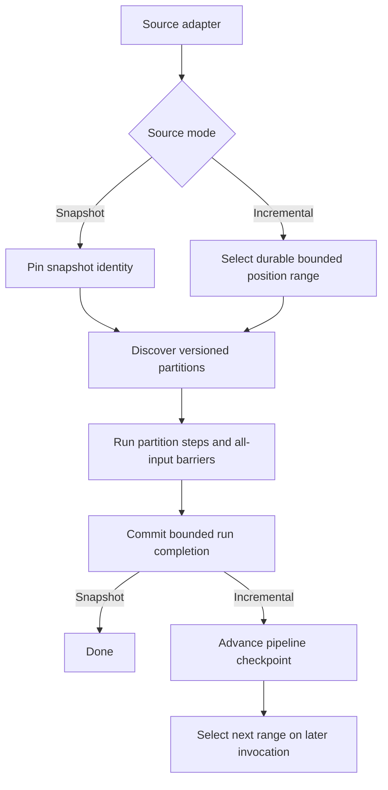
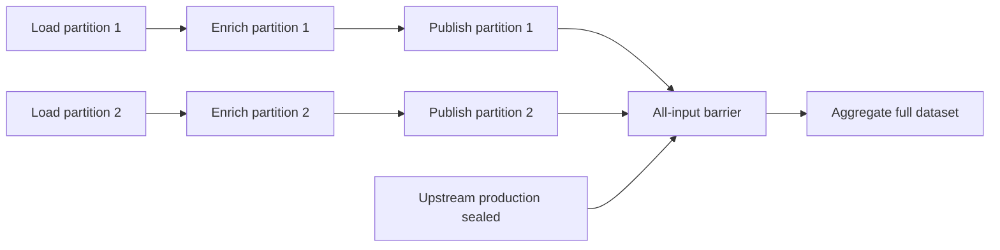
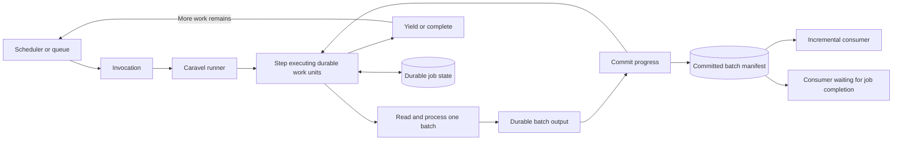
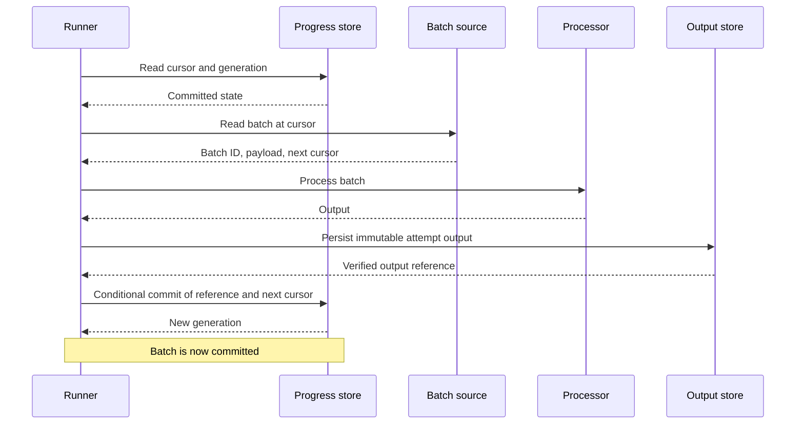
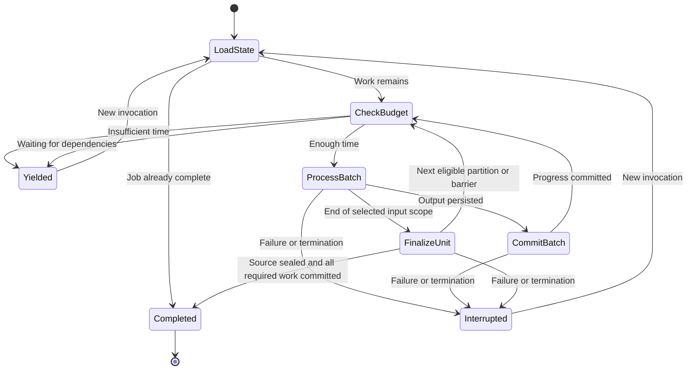
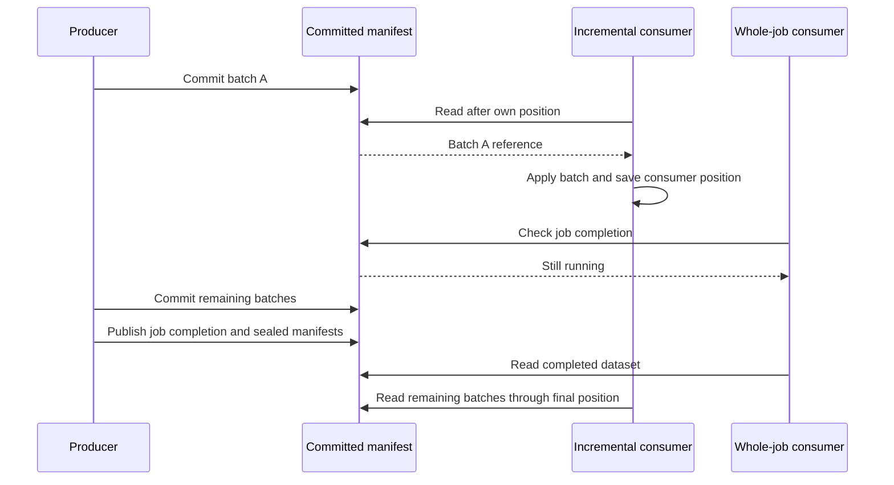

# Durable partition execution

Status: proposed. This document defines durable execution requirements, not existing behavior.

## Objective

Allow a logical job to span multiple bounded invocations without repeating all
completed work. For example, a ten-hour job must make progress through successive
invocations limited to one hour each. The same contract applies to minute-scale
limits.

Each invocation reads and processes a bounded subset of the dataset. Committed
batches become available immediately for incremental consumption; consumers may
instead wait for a durable job completion marker and read the full result.

The core abstraction is a batch/cursor interface backed by durable progress and
durable batch output. No separate orchestration wrapper is required. A scheduler,
queue, or caller is responsible for invoking work again when necessary.

## Scope

The execution model supports sequential durable work units within a unified
`Step`, continuation across process termination, safe retries, and an
optional invocation time budget. It exposes committed batches for independent
consumers with their own progress, as well as completed-job consumption. The
default single-partition input preserves simple function-based declarations.

Snapshot and incremental jobs are first-class modes of the same execution model.
Caravel provides durable source-position tracking and replay contracts; source
adapters provide snapshots or change events. It does not resume arbitrary Python
stacks, automatically split unbounded functions, capture database changes itself,
schedule invocations, or guarantee exactly-once external effects.

## Source modes and run boundaries

A stable `pipeline_id` identifies a configured processing lineage. Each bounded
logical run has a `job_id` and may span many invocation IDs. Incremental pipelines
retain their source checkpoints across runs; completing one run does not complete
or terminate the continuing pipeline.

| Source mode | Selected input | Meaning of run completion |
| --- | --- | --- |
| Snapshot | A fixed snapshot or durable manifest of versioned inputs. | All required work for that snapshot is committed. |
| Incremental | A fixed source-position range selected from a replayable change feed. | All required changes in that range are committed. Later changes belong to subsequent runs. |

Incremental mode initially uses bounded micro-batches rather than a continuously
running worker. Persist each run's start and end positions before discovery;
positions may be vectors for sharded sources. Resuming a run preserves those
bounds. New arrivals never silently expand or replace the current run's input.
The source adapter defines range inclusivity, position comparison, and ordering.

Advance the pipeline's completed-range checkpoint only after the bounded run
completes. Discovery positions and per-step progress remain independent. Initially,
incremental ranges execute sequentially within a pipeline lineage, while partitions
inside a range may run concurrently. Range allocation and checkpoint advancement
must be conditional so overlapping invocations cannot allocate conflicting ranges
or skip failed work. Reprocessing uses an explicit replay lineage rather than
resetting a live checkpoint.

An empty live source means `caught_up`, not permanently finished. The caller may
poll again later. A sealed empty range can still execute all-input steps. Source
retention gaps or unavailable historical input cause an explicit error requiring
an application-approved resnapshot or recovery; positions never silently reset.

### Input versions and change semantics

Snapshot reads retrieve the pinned version or validate its identity before use.
Incremental events identify their source position, stable entity key, operation
(`insert`, `update`, or `delete`), source revision/order token, and replayable
payload reference. Preserve this metadata through derived output and manifests.
If the source cannot replay historical contents, capture them durably at discovery.
An upper position bound alone does not freeze mutable record contents.

A mid-run update becomes a separate event in a later selected range; processing
does not substitute new contents for a pinned input. Source data remains writable:
version pins are not locks. Adapters declare consistency and ordering guarantees,
including whether positions across source shards can be compared.

Destination steps apply updates and tombstones using stable entity keys and
source-aware version checks or equivalent ordered/idempotent application. Older
work must not overwrite a newer value or resurrect a deleted entity. Applications
define derived-record cleanup, such as removing obsolete chunks after an update.
An incremental manifest describes changes; it is not automatically a materialized
full dataset. Snapshot results, change ranges, and materialized destination views
must be identified distinctly. Adapter-specific schemas and business semantics
remain outside Caravel's core.

## Architectural direction

Durable progress, committed batch publication, and crash recovery are core
execution contracts. Correctness under interruption takes priority over preserving
the current runner architecture or public interfaces. Major rewrites of execution,
persistence, planning, or plugin integration are permitted where needed to satisfy
these contracts.

Reuse existing components where they meet the requirements. Compatibility is a
preference, not an acceptance gate: breaking changes must be explicit and include
migration guidance for affected declarations, plugins, datasets, and stored state.
Existing state must either be migrated with validated semantics or rejected with
clear instructions; it must never be silently interpreted under a new contract.

The interfaces and integration choices below express required behavior and a
proposed design. They do not prescribe retaining the current implementation
boundaries. Initial topology and delivery limits bound the first release's scope,
not the architectural changes permitted to achieve it.

## Current implementation baseline

Caravel executes ordered stages and steps with optional branching. Its existing
`CheckpointPlugin` records committed persisted node outputs and enables selective
execution to load outputs from skipped nodes. These are whole-node checkpoints;
they contain no cursor for work inside a node.

The current `_persist_step_output` path validates payloads and replaces the owned
step directory before saving built-in dataset output. Reusing that path for each
batch would delete prior batch results. Resumable execution therefore requires a
distinct persistence path and explicit runner integration. Existing checkpoint
callbacks alone cannot implement this feature.

## Execution model

One logical job has a stable application-supplied `job_id`. Each invocation has a
different invocation ID but resumes the same durable job state. Each
step has a stable node ID within that job. Stable partition IDs identify
independently recoverable input subsets. Progress is durable for each
`(job_id, node_id, partition_id)` pair. Sequential execution is the default.

Each arrow requires that partition's preceding step to commit, not completion of
other partitions. A single worker may process partition 1 through every step
before starting partition 2; independent partitions may also run concurrently.

Only a committed progress record advances the cursor. An invocation resumes at
the cursor in the latest committed record, regardless of leftover files from an
interrupted attempt.

Source discovery commits partition identity and replayable input references
atomically with its discovery cursor. Discovered but unfinished partitions remain
durably eligible across invocations; advancing discovery never implies their
processing is complete. Batch progress is tracked independently for each
partition–step pair. Manifest entries include partition identity, and generations
for individual work units do not serialize unrelated partition processing.

## Proposed public contract

Names below are illustrative; implementation must preserve the semantics.

| Component | Responsibility |
| --- | --- |
| `Step` | Declares a processor, output, revision, input scope, and optional batch source/size under one durable execution contract. |
| `BatchSource.read(cursor, context)` | Reads within the pinned snapshot or bounded change range, returning a stable batch and next cursor, explicit range end, or caught-up status. Supports replay. |
| `process(batch, context)` | Processes one batch and returns its output. |
| `BatchSink` | Writes isolated durable batch output and loads output referenced by committed records. |
| `ProgressStore` | Reads state and conditionally commits progress using a generation/version check. |
| `BatchFeed` | Lists committed batch references after a consumer position and exposes node/job completion state. |
| `RetryPolicy` and retry utility | Define and execute the same retry contract at a selected step, batch, record, or operation boundary. |
| `run(..., pipeline_id=..., job_id=..., budget=...)` | Starts or continues a bounded snapshot/incremental run and returns a structured status. |

### Unified step and batching defaults

Every step executes durable work units using the same commit and recovery model.
There is no separate `ResumableStep` declaration. Durability is the execution
foundation. The default recovery boundary is a partition–step pair; batching
provides finer recovery within that pair.

| Configuration | Work and recovery boundary |
| --- | --- |
| `batch_size=None` (default) | Execute the selected input scope as one durable unit: one partition by default, or the full dataset for an all-input step. |
| `batch_size=1` | Process and commit one source record per batch. |
| `batch_size=N`, for positive integer `N` | Process and commit up to `N` source records per batch. |

Simple function declarations need no batching configuration. A positive batch
size requires a source with explicit bounded reads and replayable cursor semantics;
Caravel validates that capability before execution. The source may return fewer
than the requested maximum records, and a record may itself represent a file,
partition, or other application-defined item. Reject zero, negative, and noninteger
batch sizes. Size limits and cursor advancement must agree on the consumed input;
the runner must not discard records from an oversized source response.

Input without explicit partitions becomes one partition, preserving simple
function declarations. Arbitrary functions are not automatically split and must
fit invocation limits. Partition identity is stable across steps and invocations;
batch size subdivides work within a partition rather than regrouping partitions.
`batch_size` does not enable retries or change their scope. Whole-scope output and
batched output use the same publication contract.

### Input scope and barriers

| Configuration | Readiness and execution |
| --- | --- |
| `input_scope="partition"` (default) | Run for each partition as soon as its required upstream partition output commits, while other partitions may still be loading. |
| `input_scope="all"` | Wait for sealed upstream production and completion of every required upstream partition, then execute once logically over the full committed dataset. |

All-input steps receive a dataset reader or manifest rather than an eagerly
materialized dataset. Optional batching bounds their work within one logical
aggregate operation. Aggregate output becomes one stable partition for subsequent
steps. Partition-scoped steps preserve partition identity; arbitrary repartitioning
and partition fan-out require a separate contract.

"All" means the selected snapshot or bounded incremental range, never an endless
stream. For incremental input it contains that range's changes, not the full
current dataset; applications needing a full view supply a materialized reader.

A required failed partition keeps the barrier closed. Sealed empty input opens
the barrier over an empty dataset. Readiness survives restart; waiting holds no
worker open and an invocation yields when no eligible work remains. Job completion
requires sealed production and completion of every required work unit. Committed
sub-batches are readable through the feed, but the next partition-scoped step
waits for completion of its entire upstream partition.

A batch result contains `batch_id`, payload, and `next_cursor`. End of input is a
distinct result, not an empty payload or a null cursor. An empty batch may still
advance the cursor. The framework rejects nonterminal batches that do not advance
progress. Cursors are bounded, serializable application state, never credentials.

The source must honor the selected mode's version and replay contract. Offset
pagination over mutable collections is insufficient without stable membership
and ordering or durable input capture.

Each batch must fit within a single invocation, including source reads, processing,
output persistence, and progress publication. A processor that cannot meet that
bound must use smaller batches or expose additional checkpoints.

Sources must fetch batches without first materializing the full input dataset.
Invocation limits may include a maximum batch count or record count alongside the
time budget. A yielded invocation retains no required in-memory continuation
state; total job size does not determine the producer's working memory.

## Durable state and identity

Progress is namespaced by job ID, node ID, and partition ID, outside directories subject to
ordinary step replacement or stage cleanup.

Durable state includes:

- Schema version, pipeline ID, job ID, partition ID, node ID, and generation.
- Source mode, snapshot identity or bounded source-position range, discovery
  position, and pipeline completed-range checkpoint.
- Explicit step revision, pipeline declaration identity, input version/event metadata,
  output location, and an application-supplied fingerprint of relevant parameters.
- Next cursor, committed batch count, and node completion status.
- References to committed batch output, including stable batch IDs and integrity
  information. These may use a durable linked manifest to avoid rewriting an
  ever-growing list on every batch.
- Invocation ID and timestamps for diagnostics.

Code, source, parameters, or output identity mismatches fail before processing or
mutation. Revision checks are explicit; automatic Python code hashing is not a
correctness guarantee. Restarting with a new job ID begins separate work.

State must survive host replacement. A local store is suitable only when the
filesystem itself survives invocations and provides the required atomicity.
Remote stores must provide conditional writes or transactions. Generic `fsspec`
access alone does not establish these guarantees. Unsupported backends fail
configuration validation rather than silently weakening correctness.

## Batch commit protocol

1. Read committed state and its generation.
2. Read and process the batch at the committed cursor.
3. Write output to a unique immutable attempt location and verify persistence.
4. Atomically publish a new progress record referencing that output and the next
   cursor, conditional on the generation still matching.
5. Only after publication, regard the batch as complete and continue.

Readers see only output reachable from committed records. Unreferenced attempt
output is invisible and may be garbage-collected later; correctness must not
depend on immediate cleanup. A conflicting invocation must not overwrite a
winner's output or continue using stale progress.

If a commit response is lost, reload authoritative state before retrying. If the
matching commit is visible, continue from it. If its outcome cannot be established,
stop with an explicit uncertain-commit error; do not advance speculatively.

Processing has at-least-once semantics. Immutable output plus conditional progress
publication gives one authoritative committed result per batch. External effects
inside processing require application-level idempotency, using a stable key such
as `(job_id, node_id, partition_id, batch_id)`, or a transaction that includes those effects.

## Uniform retries

Caravel provides one retry policy and one execution mechanism reusable at any
selected boundary: step, batch, record, or individual operation. Declarative
policy attachment and a callable retry utility use the same policy type and
semantics. Developers learn one contract; pipeline objects do not each require a
different set of retry arguments.

A retry repeats the scope to which the policy is attached. A record retry repeats
one record operation; a batch retry repeats its processing scope; an ordinary
step retry repeats its selected uncommitted partition or all-input scope.
Retrying a batched step reloads authoritative
progress and preserves already committed batches. Framework commit publication
must retain its uncertain-outcome reconciliation rules under every policy.

### Policy and defaults

| Setting | Default and contract |
| --- | --- |
| Retry condition | Recognized transient failures: connection failures, timeouts, rate limits, and temporary service failures. |
| Maximum retries | Three retries after the initial attempt: at most four attempts at the selected boundary. Zero disables retries. |
| Backoff | Full jitter exponential backoff: before retry number `n` (starting at 1), sample uniformly between zero and `min(30 seconds, 1 second * 2^(n-1))`. |
| Maximum elapsed time | Bounded by the enclosing execution budget; users may set a stricter elapsed-time limit. |
| Activation | The default policy applies when retries are enabled at a selected boundary. Nested boundaries acquire no automatic retry policy. |

Conditions are user-definable predicates over a structured failure context,
including the exception, attempt number, scope identity, elapsed time, and
available error code, response status, or error text. Users can extend the default
classifier or replace it. SDK-specific status/code extraction uses explicit
adapters; arbitrary exception text is not classified as transient by default.
Successful return values are accepted unless the caller explicitly supplies a
result classifier for APIs that return failures instead of raising exceptions.
Predicate failures propagate as policy errors rather than becoming retryable.

The default classifier excludes invalid input, authentication/authorization
failures, programming errors, cancellation, and process termination. More specific
permanent classifications take precedence over broad transport categories.
Backoff, attempt limits, elapsed-time limits, and conditions are configurable.

### Nesting and deadlines

Inner retries finish before an enclosing boundary receives the failure. Selecting
multiple retry boundaries is explicit: their attempts can multiply. All nested
calls share the invocation deadline and may additionally share an explicit retry
budget limiting retry attempts across the enclosing scope. Exhausting that shared
budget prevents enclosing policies from restarting the exhausted work.

The utility checks cancellation and remaining time before waiting and before each
new attempt. It starts another attempt only when the configured attempt allowance
and shutdown margin fit within the remaining budget. Waits are cancellation-aware.
If more recoverable work remains but invocation time is insufficient, the runner
yields at a durable boundary. Retry exhaustion or a permanent failure surfaces
the final failure and attempt context without advancing uncommitted progress.

### Retry versus recovery

Retry scope and durable recovery scope are independent. Record-level retries can
run in memory within a batch, while the batch remains the durable commit boundary.
If the invocation dies, successful records in an uncommitted batch may run again.
Preserving individual record successes across invocations requires durable record
completion tracking or treating each record as a batch.

Every retried scope must be replay-safe. A timeout can occur after an external
write succeeds; retry policies do not supply exactly-once effects. Failure does
not imply rollback. Diagnostics expose scope identity, attempt count, classified
reason, and scheduled delay without logging payloads, credentials, or raw error
text by default. Automatic retries within an invocation and caller-triggered
invocation retries remain separately observable; local attempt counters alone do
not impose a lifetime retry limit on a job.

## Time budgets and continuation

An optional monotonic deadline includes a configurable shutdown margin. Before
starting another batch, the runner checks that the remaining time covers a
declared maximum batch duration plus the shutdown margin. If it does not, return
`yielded` without starting the batch. Reject a configuration where no batch can
fit within the invocation budget.

This is cooperative: the runner cannot safely interrupt arbitrary user code.
Hard termination remains correct through batch replay, but a repeatedly oversized
batch cannot make progress. Reading the source and publishing end-of-input state
must also respect the budget.

| Result | Meaning | Caller action |
| --- | --- | --- |
| `completed` | All required work and output for this bounded run are committed. | Stop invoking this job; an incremental pipeline may select another range. |
| `caught_up` | No new source range is available; the incremental pipeline remains open. | Poll or invoke again when updates arrive. |
| `yielded` | Work remains; the invocation stopped at a durable boundary. | Invoke again with the same job ID. |
| Exception/error | Processing or persistence failed, or state is incompatible. | Retry recoverable failures with the same job ID; investigate permanent failures. |

Results include the job ID, invocation ID, active node ID, and committed batch
count. A hard kill may produce no result; the caller must still arrange retry.
Reinvoking a completed job returns `completed` without processing batches again.

## Consumer contract

The output is a manifest-backed dataset readable while production is ongoing.
Consumers choose either of these modes for the same committed output:

| Mode | Availability | Completion condition |
| --- | --- | --- |
| Incremental | Read each batch as soon as its output reference is committed. | The consumer reaches the final manifest position after the selected producer scope completes. |
| Whole job | Wait for the durable job completion marker, then read the full committed dataset. | All required pipeline nodes and output publications are committed. |

The feed identifies its job and output node. It exposes stable, ordered commit
positions, batch IDs, partition IDs, source mode/version or change-range metadata,
immutable output references, schema/revision information,
and completion state. Producer cursors and consumer positions are separate: each
consumer stores its own position under its consumer identity. Listing after a
position returns committed references in order with bounded pagination.

An empty feed while production is ongoing means "no new batches yet," not end of
input. Node completion seals that node's final manifest position. Job completion
is published durably after every required node completes and identifies the
sealed output manifests. Consumers choosing whole-job mode wait for that marker,
even if their selected output node completed earlier. Producer completion does
not require consumer acknowledgment.

For incremental pipelines, completion markers seal bounded ranges. Consumers may
follow successive ranges using durable pipeline-scoped positions. Waiting for a
whole job means waiting for one selected range; continuous pipeline completion is
not implied. Change consumers apply the update/delete contract above.

Incremental consumers apply a batch to their destination before acknowledging it
in their own durable progress. A crash between application and acknowledgment
replays the batch. Destinations must support idempotent writes or transactional
application with acknowledgment: for example, vector upserts by stable document
and chunk IDs, or a data lake transaction keyed by job, node, and batch ID.
Record keys, update/delete semantics, and destination mappings are application
contracts; batch publication alone does not infer them.

The committed manifest is authoritative. Optional notifications may wake
consumers, but missed or duplicate notifications must not lose or duplicate
logical updates. Consumers catch up by listing from their durable position.
Committed references and data remain available for the job's declared retention
period; retention expiry must be explicit to lagging consumers rather than
silently skipping unavailable batches. Consumer failures do not roll back
producer commits or prevent other consumers from progressing.

## Pipeline and output integration

Downstream partition-scoped steps become eligible when their upstream partition
commits. Destination publication, such as index sync, is a normal pipeline step;
incremental delivery requires no independent consumer service. External consumers
may still use the committed feed.

Finalization seals the existing manifest without combining the entire job output
in memory or copying all batches within one invocation.

Step order is preserved within a partition. If embedding fails after enrichment
commits, enrichment output is restored and only uncommitted embedding work repeats.
All-input dependencies follow the barrier contract above. Processor calls must
fit their runtime and memory limits.

The runner must restore completed upstream outputs across invocations rather than
replaying completed ordinary steps. Existing `CheckpointPlugin` evidence may be
used for ordinary persisted boundaries. Reject configurations with required
cross-invocation upstream outputs that lack durable completion evidence or are
in-memory only. A yielded result must propagate through the runner without marking
the active node or pipeline complete.

The initial durable topology is ordered stages with partition-scoped and all-input
steps. Cross-invocation execution inside branches
is rejected until branch continuation and merge state have an explicit contract.
Single-invocation branch execution must have explicit supported behavior and
migration guidance if its execution contract changes.

Validate cleanup and path ownership before mutation: `clean_dirs` or output
replacement must never erase active progress or committed batch data. Ordinary
datasets must have explicit replacement semantics distinct from batch publication.
Batch progress and whole-node completion must have clearly defined ownership;
the existing checkpoint capability may be adapted or replaced to support that
contract.

## Failure and concurrency requirements

| Interruption point | Required recovery |
| --- | --- |
| Before or during processing | Replay the batch at the committed cursor. |
| During output write | Ignore partial uncommitted output and replay. |
| After output persistence, before progress publication | Replay; previous attempt output remains invisible. |
| After progress publication, before receiving acknowledgment | Discover the commit and continue without committing that batch twice. |
| During partition finalization | Retry idempotently; published batches remain readable, while that partition's next step waits for completion. |
| After consumer destination write, before acknowledgment | Replay that consumer's batch safely without changing producer progress. |
| Two invocations read the same generation | At most one conditional commit succeeds; loser reloads or exits with a conflict. |
| State or committed output is corrupt/missing | Fail explicitly; never silently skip work or reset the cursor. |

Single-worker execution is the default. Concurrent workers require an explicit
lease policy for eligible partition–step work: atomic claims, expiry, heartbeat
renewal, takeover, and increasing fencing tokens. Publication atomically validates
the current claim, fencing token, and expected state generation. Independent
partitions may run concurrently while dependent steps retain partition order.
Lease storage must support the required atomic operations.

Conditional publication and isolated attempt output remain mandatory. External
writes still require idempotency or destination-enforced fencing: a Caravel lease
cannot retract an external write. A release without multi-worker support must
enforce one active worker per job.

## Acceptance criteria

Verification must demonstrate:

1. A job spans several short invocations and produces the same logical output as
   uninterrupted execution, without reprocessing committed batches.
2. Fault injection at every commit boundary preserves committed output and resumes
   from authoritative progress, including a lost publication acknowledgment.
3. Concurrent invocations cannot overwrite committed batch output or advance from
   stale state; external-effect idempotency is tested separately where applicable.
4. Budget exhaustion yields before another batch starts; a hard kill replays only
   uncommitted work. Impossible batch/budget configurations are rejected.
5. Empty input, empty advancing batches, invalid nonadvancing cursors, corrupt state,
   and missing committed output have explicit tested outcomes.
6. Revision, parameter, source snapshot, and output-location mismatches are rejected
   before user processing or cleanup.
7. Completed partition–step pairs survive continuation. A partition reaches later
   steps before other partitions finish ingestion. Finalization remains bounded.
8. Cleanup cannot erase progress or committed batches; unsupported storage
   atomicity and unsupported branch placement fail during validation.
9. Supported ordinary pipelines and selective execution have regression coverage.
   Any changed public or storage contracts have migration guidance and explicit
   compatibility validation; incompatible stored state is never silently reused.
10. An incremental consumer reads committed batches before producer completion;
    a whole-job consumer waits for the job marker and sees the same logical data.
11. Independent consumers resume from their own positions after failures, tolerate
    missed/duplicate notifications, and safely replay destination writes.
12. An empty ongoing feed differs from a sealed empty result; completion markers
    identify final positions and remain discoverable after invocation failure.
13. Batch source reads, feed pagination, and invocation work limits keep processing
    bounded without loading the full dataset. Retention expiry is explicit.
14. The same retry policy works at step, batch, record, and operation boundaries.
    Defaults allow four total attempts, use the specified jittered backoff, and
    distinguish transient from permanent failures with explicit SDK adapters.
15. Custom exception/result predicates, replacement and extension of defaults,
    disabled retries, and predicate errors have verified behavior. Nested policies
    respect shared retry budgets, cancellation, elapsed limits, and invocation
    deadlines without silently enabling additional retry scopes.
16. Record retry exhaustion leaves the batch cursor uncommitted; invocation recovery
    replays that batch safely. Batched step retries preserve committed batches,
    and retries after ambiguous publication reconcile state before further writes.
17. One `Step` type supports the default `batch_size=None` and positive batch sizes.
    Default functions recover at partition–step boundaries; sizes of 1 and N recover at
    record and N-record batch boundaries respectively. Unsupported sources and
    invalid sizes are rejected before processing, and default output is published
    through the same durable commit contract as batched output.
18. Partition and all-input scopes use one `Step` type. Barriers require sealed
    production and all required partitions, survive restart, handle empty input,
    and stay closed on required failures. Aggregate output identity is stable.
19. A pipeline publishes a partition before source completion without an external
    consumer. Multi-worker support verifies lease expiry, takeover, heartbeat
    failure, and rejection of stale fenced commits; otherwise overlapping workers
    are rejected.
20. Snapshot runs reject unavailable or changed pinned input. Incremental runs
    preserve selected bounds across restarts, allocate ranges conditionally, and
    advance the pipeline checkpoint only after successful range completion.
21. Mid-run updates arrive as separate versioned work. Replay, out-of-order writes,
    and tombstones cannot overwrite newer destination state or resurrect deletions.
    Manifest lineage identifies the input versions and operations actually applied.
22. Empty live input returns caught-up status; later arrivals remain processable.
    Retention gaps fail explicitly. Incremental all-input barriers operate over
    bounded ranges, and change output is distinguished from full snapshot output.

## Delivery boundary

The smallest complete implementation includes snapshot and incremental source
contracts, bounded range selection and durable pipeline checkpoints, the unified durable step model,
partition flow and all-input barriers,
batch source/sink contracts, a durable conditional progress store, runner yield
propagation, a readable committed-batch feed with sealed manifests and durable job
completion, the shared retry policy/utility, and crash-recovery, retry, and
consumer-continuation tests. Include an example consumer that persists its own
position and applies batches idempotently, plus examples applying the same retry
policy at batch and record boundaries.
Automatic reinvocation adapters, destination-specific connectors, notification
delivery, multi-worker execution, branch continuation, and garbage collection
tooling can follow independently. Multi-worker execution includes the mandatory
lease and fencing contract; the initial release may enforce single-worker mode.
