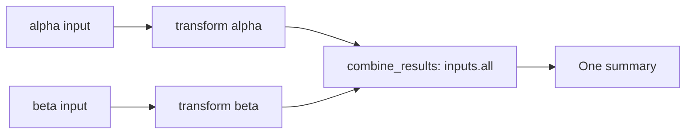

# Combining results

This example transforms partitions independently, then combines every committed
result into one summary using `inputs.all(...)`. It demonstrates aggregation,
not branch routing.

```bash
source .venv/bin/activate
python -m examples.combining_results --job-id combining-demo
```



`combine_results` waits for sealed upstream production and every required
partition. Its dataset reader exposes committed results through `partitions()`;
this small example collects them in a dictionary to include them in the summary.
For large inputs, aggregate through the reader without collecting all records.

Published output is under
`data/combining_results_example/output/combining_results_example/combining-demo/`.
The `combine` stage writes `__all__/__all__.json` containing:

```json
{
  "pipeline": "combining_results_example",
  "count": 2,
  "ids": ["alpha", "beta"],
  "total_normalized": 4.0,
  "records": {
    "alpha": {"id": "alpha", "value": 2, "normalized": 1.0},
    "beta": {"id": "beta", "value": 6, "normalized": 3.0}
  }
}
```

Repeating the command resumes the same job. A required upstream failure keeps
the aggregation blocked until recovery. For independent output per partition,
see [minimal](../minimal/README.md).
