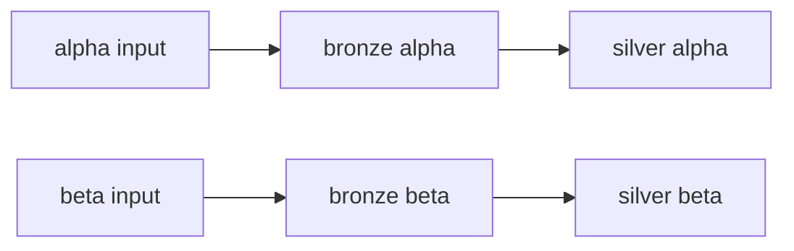

# Minimal example

Two steps process each input partition independently: `bronze_collect` doubles
its value and `silver_transform` normalizes it. Each step persists JSON output.

```bash
source .venv/bin/activate
python -m examples.minimal --job-id minimal-demo
```

Published output is under `data/minimal_example/output/minimal_example/minimal-demo/`.
The silver step produces separate `alpha/alpha.json` and `beta/beta.json` files,
with normalized values `1.0` and `3.0`. Recovery storage is the sibling `.caravel/`.
Processors iterate the available input handles and return records keyed by their
original IDs. Partitioned JSON datasets preserve those keys as filenames. There
is no all-input summary in this example.
Repeating the command resumes the same job without recomputing completed work;
use a new job ID for a separate run. Use `--output PATH` to change output location.



For combining partitions into one result, see
[combining_results](../combining_results/README.md).
